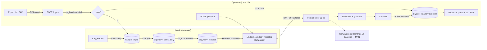

# Reabasto AI: plan del MVP

Versión 2 · 9 oct 2026 · Axel Casas

## Objetivo

Construir, en un solo dominio (reabasto de abarrotes), un flujo completo que va del dato de venta al pedido aprobado. Tiene seis pasos: ingesta desde un export tipo ERP, validación de calidad, pronóstico probabilístico de demanda, política de inventario, explicación en lenguaje de negocio con un LLM y aprobación humana con auditoría. Termina en una cifra de impacto en MXN, obtenida con una simulación contra un baseline.

El foco es entender cada herramienta en su papel: qué problema resuelve en el flujo, qué recibe, qué entrega y qué contrato la une con la siguiente. Una herramienta entra al proyecto solo si resuelve un problema concreto del flujo.

### Principios de diseño

1. **Contratos entre capas.** Cada capa lee y escribe un artefacto con esquema fijo: un Parquet, una tabla, un modelo registrado, un JSON o un endpoint. La herramienta de una capa se puede cambiar sin tocar las vecinas.
2. **El modelo calcula, el LLM explica y una persona decide.** Ningún pedido sale sin aprobación.
3. **Todo deja rastro.** Se registran las cargas rechazadas, las corridas del modelo, las llamadas al LLM y las decisiones.
4. **Reproducible desde cero.** Hay un comando `make` por capa. Los datos y los secretos nunca entran al repo, que es público.
5. **Supuestos a la vista.** Lo que el dataset no trae vive en `config/assumptions.yaml` y en el README.

## Arquitectura

Dos caminos comparten las mismas piezas. El histórico corre una vez para entrenar; el operativo se repite cada día.



Hay dos almacenes con trabajos distintos. **SQLite** guarda el estado operativo: muchas escrituras pequeñas, como propuestas, decisiones y la auditoría. **BigQuery** guarda el historial analítico: lecturas grandes por columnas para features y análisis. Es la diferencia entre OLTP y OLAP.

## Mapa de herramientas

| Herramienta | Papel en el flujo | Entra → sale | Qué entender |
| --- | --- | --- | --- |
| uv | Entorno y dependencias | `pyproject.toml` → `uv.lock` | Un lockfile fija las mismas versiones en cualquier máquina |
| Make | Orquesta los pasos | targets → artefactos | Cada target es una capa; correrlo dos veces no duplica nada |
| Polars | Recorte y limpieza | CSV de 125 M de filas → Parquet | Evaluación lazy y predicate pushdown: filtra antes de cargar |
| Parquet | Intercambio entre capas | — | Formato columnar con esquema tipado |
| BigQuery | Warehouse y features | Parquet → `sales_daily` → `features` | Load jobs vs DML; costo por bytes escaneados; particionar por fecha |
| DuckDB + SQLGlot | La misma SQL en local | SQL en dialecto BigQuery → DuckDB | Dialectos SQL; tests sin nube |
| XGBoost | Pronóstico cuantílico | features → P50 y P90 del horizonte | Pinball loss; un cuantil es un nivel de servicio |
| Contribuciones tipo SHAP | Factores por predicción | modelo + fila → 3 factores principales | Contribuciones aditivas por predicción |
| MLflow | Seguimiento y registro | corrida → métricas, artefactos, modelo `@champion` | El alias separa el entrenamiento del servicio |
| Política y simulación | Cantidad a pedir e impacto | P90 y existencias → pedido; 12 semanas → MXN | Posición de inventario, lead time, venta perdida |
| Claude API (`anthropic`) | Explicar cada propuesta | JSON de propuesta → `Explicacion` validada | Salida estructurada, guardrail, prompts versionados |
| Pydantic | Validación en las fronteras | payloads, salida del LLM, config | Validar donde entra el dato, no en medio del proceso |
| FastAPI | Puerta única del sistema | HTTP → acciones y registros | La UI y el RPA son clientes de la misma API; idempotencia |
| SQLite | Estado operativo y auditoría | propuestas, decisiones, logs | OLTP frente al OLAP de BigQuery |
| Streamlit | Aprobación humana | API → decisiones | Humano en el ciclo, con comentario obligatorio |
| RPA (por decidir) | Transporte del export | archivo → `POST /ingest` | Cuándo conviene RPA y cuándo una integración por API |
| pytest + ruff | Calidad del código | — | Cada regla y cada fórmula con su test |

## Contratos entre capas

| Artefacto | Dónde vive | Esquema (resumen) | Lo escribe | Lo lee |
| --- | --- | --- | --- | --- |
| Venta limpia | `data/clean/sales.parquet` | date, store_nbr, item_nbr, unit_sales ≥ 0, returns, onpromotion, imputed_zero | `make data` | carga a BigQuery, simulación |
| Export tipo SAP | `inbox/*.csv` | FKDAT, WERKS, MATNR, FKIMG, MEINS, LABST | `sap_export.py` | `POST /ingest` |
| Tablas | BigQuery `reabasto.sales_daily` (particionada por fecha) y `reabasto.features` | una fila por tienda, artículo y fecha, con target `y_h` | load job, SQL | entrenamiento, `/plan/run` |
| Modelos | MLflow `reabasto-demand-p50` y `-p90`, alias `champion` | firma = columnas de features | `make train` | `/plan/run` |
| Propuesta | SQLite `proposals` y JSON al LLM | ver bloque 5 | `/plan/run` | LLM, UI |
| Explicación | SQLite `llm_calls` | `resumen`, `factores`, `nivel_riesgo`, `requiere_revision` | `LLMClient` | UI |
| Decisión | SQLite `decisions` y `audit_log` | propuesta, acción, cantidad final, comentario, usuario, hora | `/decision` | export de pedidos |
| Pedido | `outbox/orders_YYYYMMDD.csv` | EBELN, EBELP, MATNR, WERKS, MENGE, MEINS, EINDT | `/orders/export` | ERP (simulado) |

## Datos y supuestos

Lo que el dataset no trae (costos, lead time, existencias) es un supuesto declarado en un archivo de configuración y en el README.

**Fuente.** [Corporación Favorita Grocery Sales Forecasting](https://www.kaggle.com/c/favorita-grocery-sales-forecasting) (Kaggle), a nivel artículo. No sirve el de "Store Sales", que viene agregado por familia y no permite pedir por SKU. Trae estos archivos:
- `train.csv`: venta diaria por fecha, tienda y artículo, con bandera de promoción.
- `items.csv`: familia, clase y si es perecedero.
- Tiendas, feriados, transacciones y precio del petróleo.

Son 54 tiendas y unos 125 millones de filas. Los archivos vienen comprimidos en `.7z` y las reglas de la competencia se aceptan en la web antes de usar la CLI.

**Recorte.**
- Periodo del 2016-01-01 al 2017-08-15, que es el fin del dataset. Así se evitan los años con promoción nula.
- 5 tiendas abiertas todos los días del tramo de entrenamiento salvo los cierres nacionales (2016-01-01, 2016-12-25 y 2017-01-01, detectados porque casi ninguna tienda reporta venta); entre ellas, las de mayor volumen.
- 2 familias: GROCERY I (no perecedera) y DAIRY (perecedera).
- Los ~100 artículos más vendidos de cada familia, **elegidos solo con datos de entrenamiento**. Si se eligen con todo el periodo, se filtra información del futuro.
- En total, unas 1,000 series tienda-artículo y unas 600 mil filas. Como el disco no alcanza para el CSV descomprimido (~5 GB), `7zz e -so` descomprime a una tubería y `pyarrow.csv.open_csv` filtra por lotes; solo el recorte se escribe a Parquet. Polars (`scan_parquet`, lazy) hace la selección y la limpieza sobre ese recorte.

**Cortes temporales.**

| Tramo | Fechas | Uso |
| --- | --- | --- |
| Entrenamiento | 2016-01-01 a 2017-03-28 | ajustar modelos |
| Validación | 2017-03-29 a 2017-05-23 (8 semanas) | hiperparámetros, calibración del P90, backtest |
| Simulación | 2017-05-24 a 2017-08-15 (12 semanas) | solo la cifra de impacto; no se toca antes |

El target suma los H días siguientes. Por eso las filas de cada tramo terminan H días antes del corte; sin ese hueco, el entrenamiento vería datos de validación.

**Rarezas del dataset que se vuelven reglas o features:**
- Los días sin venta no vienen en el archivo ([fueron eliminados](https://forums.fast.ai/t/corporacion-favorita-grocery-sales-forecasting/8359)). Se reconstruyen con cero y se marcan con `imputed_zero`.
- Las ventas negativas son devoluciones: van en una columna aparte y no cuentan como demanda.
- Hay artículos a granel con cantidades fraccionarias. La unidad (MEINS) debe ser consistente por artículo y solo se aceptan fracciones con KG.
- La promoción viene nula en los primeros años. El recorte lo evita, pero la regla se queda.
- El terremoto del 16 de abril de 2016 en Ecuador dejó ventas atípicas durante semanas. Se marca con una bandera o se excluye del entrenamiento.
- Quincena: los salarios del sector público se pagan el 15 y el último día del mes. Es un feature: días de pago dentro del horizonte.
- Los feriados tienen traslados (`transferred`) y alcance nacional, regional o local. Se unen por ciudad y estado de la tienda.
- Venta no es lo mismo que demanda: si no hubo existencia, no hubo venta (demanda censurada). Se usa la venta como demanda y se declara como limitación.

**Export tipo SAP.** Un script toma un día del recorte y lo escribe como lo exportaría un ERP, con nombres de campo estándar de SAP ECC/S4. Con `--inject-errors` genera un archivo defectuoso para probar los rechazos. El mapeo va en `docs/sap_mapping.md`:

| Campo SAP | Tabla de origen en SAP | Significado | Origen en el proyecto |
| --- | --- | --- | --- |
| MATNR | VBRP | Número de material | `item_nbr` |
| WERKS | VBRP | Centro (tienda o CEDIS) | `store_nbr` |
| FKDAT | VBRK | Fecha de factura | `date` |
| FKIMG | VBRP | Cantidad facturada | `unit_sales` |
| MEINS | VBRP | Unidad de medida base | KG para granel; PC para el resto |
| LABST | MARD | Existencia de libre utilización | Simulada |

En un ERP real, venta y existencia salen de tablas distintas y el extractor las une; aquí van en un solo archivo para simplificar. Otros ERPs, como SAP Business One, usan otros nombres de campo: cambia el mapeo, no el pipeline.

**Supuestos iniciales** (en `config/assumptions.yaml`, ajustables):

| Supuesto | Valor inicial |
| --- | --- |
| Lead time (L) | 3 días perecederos, 7 días no perecederos |
| Revisión de inventario (R) | Diaria, así que el horizonte es H = L + 1: 4 u 8 días |
| Costo unitario | Fijo por familia, en MXN |
| Costo de mantener inventario | Porcentaje diario del costo, mayor en perecederos |
| Costo de quiebre | Margen perdido por unidad no vendida |
| Nivel de servicio objetivo | 90%, que corresponde al cuantil P90 |
| Inventario inicial de la simulación | El nivel objetivo de cada política el día 0 |
| Redondeo del pedido | Entero hacia arriba; KG a un decimal |

El dataset no trae precios ni costos, así que la cifra de impacto sale de una simulación con supuestos y se presenta junto con ellos.

## Bloques de trabajo

Son unas 18 horas en seis bloques, más uno opcional. Primero va lo que da valor al proyecto (modelo, simulación y LLM) y al final la automatización alrededor, para que cada bloque terminado deje algo que funciona. Cada bloque dice qué construyes, qué entender y cuándo está listo.

### 1. Setup (~2 h)

- Crea el repo con uv (Python 3.12), ruff y pytest.
- Pon en `.gitignore` las carpetas `data/`, `inbox/` y `outbox/`, el archivo `.env`, `mlflow.db`, `mlruns/` y los `*.sqlite`. Agrega un `.env.example` sin valores.
- En Mac, corre `brew install uv sevenzip libomp`: `libomp` lo necesita XGBoost en macOS y `7zz` descomprime los `.7z`. Instala también Google Cloud CLI.
- Instala la CLI de Kaggle con `uv tool install kaggle`. El token va en `~/.kaggle/` con permisos 600, y las reglas de la competencia se aceptan antes en la web.
- Activa el [sandbox de BigQuery](https://cloud.google.com/bigquery/docs/sandbox) en un proyecto nuevo y corre `gcloud auth application-default login`. El sandbox no pide tarjeta, pero tiene límites:
  - 10 GB de almacenamiento y 1 TB de consultas al mes.
  - Las tablas expiran a los 60 días.
  - No permite DML ni streaming.

  Por eso los datos limpios viven en Parquet y BigQuery se recrea con un comando.
- Guarda la API key de Anthropic en `.env` y léela con `pydantic-settings`. Nunca va en el código.
- **Qué entender:** Application Default Credentials. El cliente de BigQuery encuentra las credenciales en el entorno sin una key en el código, y la API key del LLM sigue el mismo principio.
- **Listo cuando:** `make check` (ruff + pytest) pasa y un script de Python consulta BigQuery.

### 2. Datos, calidad y features (~3 h)

- **Datos:** `make data` descarga, descomprime y recorta a Parquet con Polars. Reconstruye los días en cero y separa las devoluciones.
- **Reglas de calidad (`quality/rules.py`):** cada regla es una función con id, severidad (bloqueante o advertencia) y mensaje. Cada una tiene su test sobre un fixture que trae el defecto.
  - El score de una carga es la proporción de reglas que pasan, ponderada por severidad. Cualquier falla bloqueante rechaza la carga.
  - Reglas: esquema y tipos; obligatorios no nulos; MATNR y WERKS existen en el maestro; FKDAT es la fecha esperada y no es futura; sin duplicados por (MATNR, WERKS, FKDAT); FKIMG negativo se separa como devolución; fracción solo con MEINS = KG; número de filas dentro de ±X% del promedio de 28 días; LABST ≥ 0.
- **Export y carga:** `ingest/sap_export.py` genera el export diario tipo SAP. `ingest/load_bq.py` sube el Parquet a BigQuery con un load job, en una tabla particionada por fecha.
- **Features (`features/features.sql`, en dialecto BigQuery):**
  - Rezagos de 7, 14 y 28 días; medias móviles de 7 y 28; desviación de 28.
  - Día de la semana y si el artículo es perecedero.
  - Dentro del horizonte H: días de promoción, feriados y días de quincena.
  - Target `y_h`: la venta sumada de t+1 a t+H.
  - Se materializa con un query job con tabla destino, no con DML.
- **Misma SQL en local:** la SQL se transpila con SQLGlot y corre en DuckDB sobre el Parquet. Sirve para los tests y para correr sin nube (`ENGINE=duckdb`).
- **Qué entender:**
  - Por qué el filtro va antes de `collect()`.
  - La diferencia entre un load job y DML.
  - Cómo las particiones bajan los bytes escaneados.
  - Las trampas de dialecto. Por ejemplo, en BigQuery `DAYOFWEEK` va de 1 (domingo) a 7 y en DuckDB `dayofweek` va de 0 (domingo) a 6. Un test de paridad lo detecta.
- **Listo cuando:** la tabla `features` está en BigQuery, la misma SQL pasa en DuckDB sobre un fixture y los tests pasan.

### 3. Modelo (~4 h)

- **Target:** la demanda acumulada del horizonte (lead time más un día de revisión), no la diaria. Sumar cuantiles diarios no da el cuantil del total.
- **Modelos:** XGBoost con `objective="reg:quantileerror"`, uno con `quantile_alpha=0.5` y otro con `0.9`.
  - Separados, cada uno se registra y se explica por su cuenta. Las versiones recientes pueden entrenar varios cuantiles en un modelo; verifícalo en la tuya.
  - Si en alguna fila el P90 queda debajo del P50 (cruce de cuantiles), se sube al P50.
- **Baseline:** promedio móvil de 28 días × H.
- **Backtest:** origen móvil en la ventana de validación, con un corte por semana y un hueco de H días. Métricas por familia:
  - WAPE del P50.
  - Pinball loss de ambos cuantiles.
  - Cobertura real del P90: la fracción de casos con venta ≤ P90, que debe quedar cerca de 90%.
- **Calibración:** si la cobertura se aleja (por ejemplo, 84%), se ajusta en validación un factor multiplicativo sobre el P90 que la lleve a 90%. El factor se registra como parámetro.
- **MLflow** (backend local `sqlite:///mlflow.db`):
  - Cada corrida guarda parámetros, métricas, artefactos (curva de cobertura e importancia de features) y el modelo con su firma.
  - Se registran `reabasto-demand-p50` y `-p90`.
  - El alias `champion` se mueve solo si el modelo le gana al baseline en pinball loss y su cobertura queda dentro de ±3 puntos de 90%.
  - La API carga `models:/reabasto-demand-p90@champion` y nunca una ruta de archivo.
  - Revisa la API de tu versión: en MLflow 3.x, `log_model` usa `name`.
- **Factores:** `pred_contribs=True` sobre el modelo P50 da la contribución de cada feature por fila. Las 3 de mayor magnitud se traducen a lenguaje de negocio con `features/glossary.yaml`; por ejemplo, `lag_7` → "venta de hace una semana".
- **Qué entender:** la pinball loss y por qué el cuantil 0.9 es un nivel de servicio; la fuga de información en series de tiempo; la cobertura como prueba de calibración; cómo el registro y el alias separan el entrenamiento del servicio.
- **Listo cuando:** MLflow muestra el modelo contra el baseline, con la cobertura del P90, y el alias `champion` está asignado.

### 4. Política y simulación (~3 h)

- **Política** (revisión diaria, order-up-to):
  - El nivel objetivo S es el P90 calibrado del horizonte.
  - La posición de inventario es la existencia más lo que viene en tránsito.
  - El pedido es max(0, S − posición), redondeado según la unidad.
- **Simulación:** día por día durante las 12 semanas reservadas, serie por serie.
  - Cada día llegan los pedidos hechos hace L días, se vende min(demanda, existencia) y lo que falta es venta perdida. Luego se recalcula la posición y se pide.
  - La demanda es la venta histórica del tramo.
  - El modelo queda congelado, entrenado hasta el fin de validación, y las features de cada día solo usan ventas hasta ese día.
- **Baseline:** promedio móvil de 28 días × (H + k días fijos de cobertura).
- **Comparación justa:**
  - Barre k en el baseline y el nivel de servicio en el modelo (cuantiles de 0.80 a 0.95; entrenar cuantiles extra es barato).
  - Grafica el inventario promedio contra el fill rate para las dos políticas.
  - La cifra principal sale de comparar ambas curvas al mismo fill rate: "−X% de inventario en MXN con el mismo fill rate".
- **Métricas por familia:** inventario promedio en MXN, fill rate (unidades vendidas / demanda), días con quiebre y costo total (mantener + quiebre).
- **Tests:** conservación del inventario (inicial + recepciones − ventas = final), pedido nunca negativo y una serie sin demanda.
- **Qué entender:** la diferencia entre posición de inventario y existencia; por qué el lead time define el horizonte; por qué se compara al mismo nivel de servicio; el efecto de la demanda censurada.
- **Listo cuando:** tienes la curva y la cifra principal.

### 5. API, estado y LLM (~3 h)

**API (FastAPI):**

| Endpoint | Qué hace |
| --- | --- |
| `POST /ingest` | Recibe el CSV, corre las reglas y responde score, estado y motivos. Es idempotente: el SHA-256 del archivo evita cargarlo dos veces si el cliente reintenta |
| `POST /plan/run` | Para una fecha: features, modelos `@champion`, política, propuestas pendientes y explicaciones |
| `GET /proposals` | Lista propuestas por fecha y estado |
| `POST /proposals/{id}/decision` | Aprueba, ajusta o rechaza; ajustar y rechazar exigen comentario |
| `GET /orders/export` | Pedidos aprobados como CSV tipo SAP (deseable) |
| `GET /health` | Estado del servicio |

- **Seguridad:** un header `X-API-Key`. Cada key corresponde a un usuario definido en `.env`, así la auditoría sabe quién decidió. Los secretos solo viven en `.env`.
- **Estado:** SQLite con `sqlite3` y un esquema explícito en `store/schema.sql`. Tablas: `loads`, `proposals`, `decisions`, `llm_calls` y `audit_log`; esta última solo admite inserciones. BigQuery queda para análisis.

**LLM.** No decide nada: explica en lenguaje de negocio cada pedido que el modelo ya calculó.

- **Interfaz:** `LLMClient` tiene un solo método, `explain(propuesta)`. Tres implementaciones:
  - `AnthropicClient` (principal): usa el SDK `anthropic`. `client.messages.parse(..., output_format=Explicacion)` devuelve en `response.parsed_output` una instancia de Pydantic ya validada. El modelo y el esfuerzo vienen de la config: por defecto `claude-opus-5-5` con esfuerzo bajo, y `claude-haiku-5-5` como opción barata si el costo pesa. El prompt de sistema es fijo, así que se aprovecha el prompt caching.
  - `GatewayClient` (alterno): un endpoint compatible con OpenAI, como el AI Gateway de Lovable. Antes de depender de él, confirma que su key funciona fuera de Lovable Cloud y que los términos lo permiten.
  - `FakeLLMClient`: respuestas fijas para los tests, sin red.
- **Prompts:** versionados en `llm/prompts/explain_v1.md`. La versión es el nombre del archivo más un hash de su contenido.
- **Entrada:** un JSON por propuesta con:
  - SKU, tienda, fecha, existencia y en tránsito.
  - P50 y P90 del horizonte, nivel objetivo, cantidad propuesta y días de cobertura.
  - Los 3 factores principales, cada uno con nombre de negocio, dirección y magnitud en unidades.
  - Los números derivados que la explicación podría necesitar, ya calculados (como la diferencia contra el P50). El LLM no hace cuentas.
- **Salida (Pydantic):** `resumen` (2 oraciones), `factores` (lista), `nivel_riesgo` (bajo, medio o alto) y `requiere_revision` (booleano).
- **Guardrail numérico:** extrae cada número del texto (miles, decimales, porcentajes y signos) y verifica que exista en el JSON de entrada, con tolerancia de redondeo.
  - Si falla, reintenta una vez y le dice al modelo qué números no existen.
  - Si vuelve a fallar, usa una plantilla determinística y marca `requiere_revision`.
  - La tasa de fallas es una métrica del sistema.
- **Registro:** cada llamada guarda en `llm_calls` la versión del prompt, el modelo, la entrada, la salida, la latencia, los tokens de entrada y salida (de `response.usage`), el costo calculado con la tabla de precios de la config, el resultado del guardrail y los reintentos.
- **Alcance y costo:** solo se explican las propuestas de `/plan/run` con pedido mayor que cero, nunca los días simulados. Antes de una corrida completa, mide los tokens de 10 propuestas y estima el costo.
- **Datos que salen al proveedor:** solo los campos del JSON de propuesta. No hay datos personales. Se documenta en `docs/data_flows.md`.
- **Evaluación:** revisa a mano de 20 a 30 propuestas con una rúbrica de 3 criterios (fiel a los datos, útil para decidir y clara para alguien de compras). El puntaje promedio y la tasa de paso del guardrail van en `docs/llm_eval.md`.
- **Qué entender:** salida estructurada frente a texto libre; por qué el guardrail vive fuera del modelo; la idempotencia; por qué la auditoría solo admite inserciones.
- **Listo cuando:** una corrida desde la API (ingesta, plan, propuestas explicadas y una decisión) queda registrada de punta a punta.

### 6. App, documentación y cierre (~3 h)

- **Streamlit** habla solo con la API, con su propia key, y nunca lee SQLite directo. Así cada decisión pasa por la misma validación y queda en la auditoría. Tiene cuatro pestañas:
  - **Propuestas:** explicación, nivel de riesgo y botones para aprobar, ajustar o rechazar, con comentario.
  - **Impacto:** la curva y la cifra principal.
  - **Calidad:** cargas y rechazos.
  - **LLM:** tasa de paso del guardrail y costo.
- **README en inglés:** problema, arquitectura, cómo correrlo, supuestos, resultados y limitaciones.
- **Documentación en `docs/`:**
  - `architecture.md`: mapa de herramientas y contratos.
  - `sap_mapping.md`, `data_flows.md` y `llm_eval.md`.
- **Video o GIF** de 2 minutos con el recorrido de punta a punta.
- **Listo cuando:** alguien clona el repo y lo corre siguiendo el README.

### 7. Automatización del ingreso (opcional, ~1–2 h; herramienta por decidir)

El contrato ya está fijo, así que la herramienta se puede elegir después:
- Vigila `inbox/`, toma cada CSV nuevo y llama a `POST /ingest` con su `X-API-Key`.
- Según la respuesta, mueve el archivo a `processed/` o `rejected/` y escribe una línea de log.
- Si la API no responde, reintenta con espera. Como `/ingest` es idempotente, reintentar no duplica cargas.
- El flujo exportado se guarda en `rpa/`.

Mientras tanto, `scripts/send_export.sh` (curl) hace lo mismo a mano.

Opciones a evaluar en Mac:
- **n8n en Docker:** corre nativo, tiene trigger de archivo local y nodo HTTP, y el flujo se exporta como JSON.
- **Power Automate Desktop o UiPath Studio en una VM con Windows:** es RPA de interfaz. No hay soporte confirmado de Power Automate Desktop en Windows 11 ARM.
- **Un watcher en Python:** el sustituto mínimo.

**Qué entender:** RPA sirve cuando el sistema de origen no tiene API y hay que operar su interfaz. Aquí el bot solo transporta archivos; toda la lógica vive en la API, y por eso el bot es reemplazable.

## Recorrido de una carga de punta a punta

1. `sap_export.py` deja `inbox/ventas_2017-05-24.csv` con campos tipo SAP.
2. El bot (o curl) lo envía a `POST /ingest`. La API calcula su hash y, si ya lo vio, devuelve el resultado anterior.
3. Las reglas de calidad dan un score. Con una falla bloqueante, la carga se rechaza y el motivo queda en `loads`. Si pasa, se anexa al Parquet y se carga a BigQuery con un load job.
4. `POST /plan/run` calcula las features del día con la misma SQL, en BigQuery o en DuckDB.
5. La API carga los modelos `@champion` desde MLflow y obtiene P50, P90 y factores por serie.
6. La política convierte el P90, la existencia y el tránsito en una cantidad a pedir. Las propuestas quedan pendientes en SQLite.
7. Para cada propuesta con pedido mayor que cero, `LLMClient` genera la explicación, el guardrail la valida y `llm_calls` registra todo.
8. En Streamlit, alguien aprueba, ajusta o rechaza. La API guarda la decisión y agrega una fila a `audit_log`.
9. `GET /orders/export` escribe los pedidos aprobados como CSV tipo SAP en `outbox/`, listos para que el ERP los tome.
10. Por separado, la simulación aplica la misma política a 12 semanas para medir el impacto en MXN.

## Prioridades y líneas de corte

Si vas atrasado, corta desde abajo de esta tabla. Nunca cortes el LLM ni la cifra de impacto.

| Prioridad | Qué entra |
| --- | --- |
| Imprescindible | Recorte y limpieza, modelo por cuantiles con backtest en MLflow, simulación con la cifra en MXN, explicaciones del LLM con guardrail, README |
| Deseable | BigQuery (si da problemas, la misma SQL corre en DuckDB), score de calidad con rechazo, API con aprobación y auditoría, Streamlit, export de pedidos |
| Extra | Automatización del ingreso (bloque 7), métricas de Prometheus, asignación con PuLP, extracción de confirmaciones de proveedor, Docker Compose |

## Extensiones

- **Confirmaciones de proveedor.** Un correo o PDF dice algo como "entregamos el martes 80 cajas en vez de 120". El LLM extrae fecha, cantidad y SKU a un esquema, y una regla lo valida contra el pedido abierto. Si cuadra, actualiza la recepción esperada en la simulación. Usa de 10 a 15 correos sintéticos. Es procesamiento inteligente de documentos: el LLM extrae y una regla decide.
- **Prometheus.** Un endpoint `/metrics` en FastAPI con:
  - Contadores de cargas aceptadas y rechazadas, de propuestas por decisión y de fallas del guardrail.
  - Un histograma de latencia del LLM.

  Prometheus lee ese endpoint periódicamente (modelo pull).
- **PuLP.** Cuando el CEDIS no alcanza para todos los pedidos, un programa lineal reparte la oferta disponible minimizando el costo esperado de quiebre, ponderado por margen.
- **Docker Compose.** Levanta la API, Streamlit, MLflow y Prometheus con un comando.

## Fuera de alcance

- Deep learning para el pronóstico: con unas 1,000 series tabulares, XGBoost basta.
- Pronóstico jerárquico y reconciliación.
- Inventario multi-escalón.
- Precios y promociones óptimas.
- Despliegue en la nube y autenticación real (OAuth/SSO).

## Estructura del repo

Un paquete con un módulo por capa, para que cada bloque toque una sola carpeta.

```
reabasto-ai/
├── config/assumptions.yaml
├── data/                  # fuera de git
├── inbox/  outbox/        # fuera de git: exports de entrada y pedidos de salida
├── docs/
│   ├── PLAN.md
│   ├── architecture.md
│   ├── data_flows.md
│   ├── sap_mapping.md
│   └── llm_eval.md
├── src/reabasto/
│   ├── ingest/            # recorte, export tipo SAP, carga a BigQuery
│   ├── quality/           # reglas y score por carga
│   ├── features/          # SQL de features, glosario, motor BigQuery/DuckDB
│   ├── models/            # entrenamiento, backtest y registro en MLflow
│   ├── policy/            # política de inventario y simulación
│   ├── llm/               # LLMClient, prompts versionados, guardrail
│   ├── api/               # FastAPI
│   └── store/             # SQLite: esquema y acceso
├── app/streamlit_app.py
├── rpa/                   # flujo exportado (bloque 7)
├── scripts/send_export.sh
├── tests/
├── .env.example
├── Makefile               # setup, data, load, features, train, simulate, api, app, demo, check
└── README.md
```

## Checklist de cierre

- [ ] El repo corre desde cero siguiendo el README
- [ ] La cifra de impacto está en el README, junto con sus supuestos y la curva de inventario contra fill rate
- [ ] `data/`, `inbox/`, `outbox/`, `.env`, `mlflow.db` y los `.sqlite` están fuera de git
- [ ] Los datos de Kaggle no se suben al repo; revisa las reglas de la competencia
- [ ] No hay API keys en el historial de git (revísalo con `gitleaks` o similar)
- [ ] No hay datos ni código de terceros
- [ ] `make check` pasa
- [ ] El video o GIF de 2 minutos está grabado
